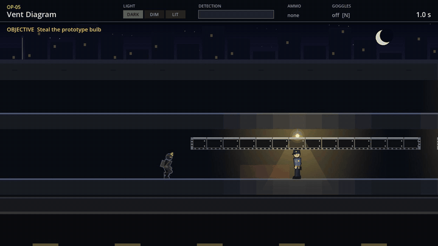
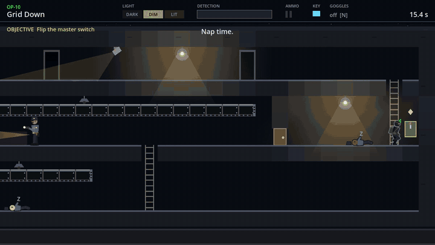

# Dimmer Switch

**Every lamp is your enemy.** A free side-view stealth game about light and shadow: shoot out the lamps, crawl through the vents, step into dark doorways and sneak past guards, cameras and invisible lasers.

▶ **[Play free in your browser](https://ahab94.github.io/dimmer-switch/)** (works on phones too) · ⬇ [Windows / Mac / Linux downloads](https://github.com/ahab94/dimmer-switch/releases/latest)



You work the night shift for **Third Shift**, a spy agency taking down OmniBulb Corp and its plan to keep every light on forever: *Project Eternal Daylight*. Ten missions, each with a job to do before you can get out.

## How it plays
- **Light is everything.** Guards spot you from 9 tiles away in full light, 5 in dim light, and only right next to you in the dark. The LIGHT meter shows where you stand.
- **Shoot the lights.** Limited ammo; a broken lamp stays dark (and saves 60 W). Glass is loud up close.
- **Doorways:** step back into a dark doorway and the guard walks right past you.
- **Air ducts:** crawl through the vents over the guards' heads. Nobody ever checks the vents.
- **Noise:** running is twice as fast, but guards within 4 tiles hear it.
- **Takedowns** from behind. Other guards (and cameras) raise the alarm if they find the body.
- **Cameras** sweep, but only see in the light. **Lasers** are invisible without night vision.
- **Objectives:** hack a terminal, photograph a document, plant a bug... The exit stays locked until it's done.
- Detection is a meter, not instant failure. Ratings: GHOST (never noticed, no takedowns), SHADOW, NOTICED.



## Controls
| Action | Keyboard | Touch |
| --- | --- | --- |
| Move / climb / enter vents | WASD or arrow keys | joystick |
| Run | Shift | push the joystick all the way |
| Use objective / takedown | E | USE |
| Shoot nearest lamp | F | SHOOT |
| Night vision | N | NV |
| Restart / pause | R / Esc | pause button |

## Install in one line
macOS / Linux:
```bash
curl -fsSL https://raw.githubusercontent.com/ahab94/dimmer-switch/main/install.sh | bash
```
Windows (PowerShell):
```powershell
irm https://raw.githubusercontent.com/ahab94/dimmer-switch/main/install.ps1 | iex
```

## Missions
OP-01 Night Shift · OP-02 Pools of Light · OP-03 Energy Audit · OP-04 Squeaky Sneakers · OP-05 Vent Diagram · OP-06 Lights Out, Lads · OP-07 Smile, You're on Camera · OP-08 Invisible Red Tape · OP-09 Access Denied · OP-10 Grid Down

## How it's built
Godot 4.7 and GDScript, with every character, light and sound made in code (no art or audio assets). The rules are pure functions of time (`scripts/world.gd`), so a planning autopilot can prove every mission is winnable without ever being seen. That's a check on every commit (`bash checks/verify.sh`), and it's also the "player" in the trailer and Shorts.

If you enjoy it, a ⭐ on the repo helps a lot.

## Roadmap
- [x] v0.1.0: 10 missions with objectives and briefings, light and shadow, doorways, air ducts, ladders, shooting lamps, noise, takedowns, doors, cameras, lasers + night vision, keycards, flashlight guards, blackout finale, touch controls with portrait and landscape layouts, saves, autopilot gate
- [x] v0.1.1: in-game music and sound (thriller theme with a tension layer, synthesized effects)
- [ ] Difficulty tuning with a "rookie" bot
